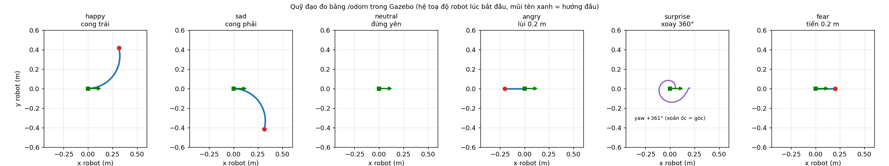

# Bài thực hành 08 – Nhận diện biểu cảm khuôn mặt và điều khiển TurtleBot 4

Webcam → **OpenCV** → **DeepFace** (CNN Emotion, FER-2013) → làm mượt theo thời gian → `/emotion` →
`emotion_motion_node` → **`/cmd_vel`** → TurtleBot 4 trong Ignition Gazebo (ROS 2 Humble).

| Biểu cảm | Hành động | Cách thực hiện |
|---|---|---|
| Happy | Cong sang trái | v = 0.15 m/s, ω = +0.45 rad/s trong 4 s (R ≈ 0.33 m, ~103°) |
| Sad | Cong sang phải | v = 0.15 m/s, ω = −0.45 rad/s trong 4 s |
| Neutral | Dừng tại chỗ | gửi lệnh 0 |
| Angry | Lùi nhẹ | v = −0.10 m/s tới khi `/odom` báo lùi được 0.20 m |
| Surprise | Xoay một vòng | ω = 1.0 rad/s tới khi tích luỹ yaw từ `/odom` đủ 360° |
| Fear | Tiến nhẹ | v = 0.10 m/s tới khi đi được 0.20 m |
| (không thấy mặt) | Dừng | an toàn |



## Cấu trúc

```
btth8/
  nodes/
    emotion_core.py           DeepFace/FER + bộ làm mượt nhãn (không phụ thuộc ROS)
    motion_plans.py           định nghĩa quỹ đạo + bộ thực thi theo thời gian / quãng đường / góc (không phụ thuộc ROS)
    emotion_detector_node.py  webcam -> /emotion, /emotion/scores, /emotion/image + cửa sổ hiển thị thời gian thực
    emotion_motion_node.py    /emotion -> /cmd_vel; tự undock, tiến ra giữa sân; /emotion_motion/status
  tests/
    test_motion_plans.py      kiểm thử quỹ đạo + bộ làm mượt (không cần ROS)
    run_trajectories.py       kiểm thử trên Gazebo: phát 6 biểu cảm, đo /odom, vẽ figures/trajectories.png
    cam_test.py               thử webcam + DeepFace không cần ROS
  scripts/
    setup.sh                  cài phụ thuộc (một lần)
    01_sim.sh                 Gazebo + TurtleBot 4, world open_arena (sân trống 7 x 7 m của bài 06)
    02_motion.sh              node điều khiển
    03_detector.sh            node nhận diện (webcam)
    run_demo.sh               mở cả 3 bước trong các tab terminal
    send_emotion.sh           giả lập biểu cảm, bỏ qua webcam:  ./scripts/send_emotion.sh surprise
    cam_test.sh, test_run.sh, stop_all.sh
```

## Cài đặt

```bash
cd btth8
./scripts/setup.sh
```

Không cần `colcon build`: các node là script Python chạy bằng `/usr/bin/python3` (có `rclpy`). `setup.sh` cài
`numpy<2`, `tensorflow-cpu==2.15.1`, `tf-keras`, `deepface==0.0.93` vào `btth8/.pydeps` (~1.2 GB) và tải trọng số
model Emotion (~6 MB, `~/.deepface`). Một số điểm cần lưu ý:
- `~/.local` có numpy 2.x, còn cv2 hệ thống và TF 2.15 cần numpy 1.x, nên `scripts/env.sh` chỉ đưa `.pydeps` lên đầu
  `PYTHONPATH` cho bài này.
- `deepface` được cài với `--no-deps` để pip không kéo `opencv-python` về đè OpenCV hệ thống.
- DeepFace đặt `TF_USE_LEGACY_KERAS=1`, nên TF 2.15 cần thêm gói `tf-keras`.
- OpenCV bản apt để Haar cascade ở `/usr/share/opencv4/haarcascades`, khác chỗ DeepFace tìm, nên `emotion_core.py`
  tự trỏ lại đường dẫn này.

## Chạy demo

```bash
./scripts/run_demo.sh                       # Sim, Motion, Detector
./scripts/run_demo.sh -p device:=1          # webcam khác
```

Hoặc chạy từng bước, mỗi lệnh một terminal:

```bash
./scripts/01_sim.sh          # đợi robot xuất hiện trên dock (30–60 s)
./scripts/02_motion.sh       # tự undock, tiến ra 1 m rồi báo "Sẵn sàng – bắt đầu nhận lệnh biểu cảm"
./scripts/03_detector.sh     # cửa sổ camera; làm biểu cảm trước webcam
```

Cửa sổ camera hiển thị: khung mặt kèm nhãn và độ tin cậy tức thời, thanh điểm của 6 lớp (đã làm mượt), dòng trên
cùng "BIỂU CẢM → hành động", và panel TurtleBot (hành động đang chạy, v/ω, tiến độ, số lượt). Phím: `q` thoát,
`SPACE` tạm dừng (robot dừng), `s` lưu ảnh vào `figures/`. Ảnh đã vẽ cũng được phát trên `/emotion/image`.

## Đưa robot về chỗ cũ

Node điều khiển nhớ vị trí và hướng của robot lúc "Sẵn sàng" (sau khi undock và tiến ra giữa sân). Để robot quay
về đó (dựa vào `/odom`: quay mặt về điểm, đi thẳng, rồi quay lại đúng hướng cũ):

```bash
./scripts/go_home.sh            # hoặc bấm phím h trên cửa sổ camera
./scripts/go_home.sh sethome    # lấy vị trí hiện tại làm "chỗ cũ" mới
```

Lệnh nằm trên topic `/emotion_motion/command` (`home`, `sethome`, `cancel`). Khi đang về, robot bỏ qua biểu cảm.
Đã thử trên Gazebo: cho robot cong trái rồi xoay, sau `go_home` sai số khoảng 4 cm và 1°. Bộ điều khiển không né
vật cản, nên chỉ phù hợp với sân trống. Muốn robot vào lại dock sạc thì dùng action `/dock` của Create 3.

## Thiết kế

**Nhận diện** (`emotion_detector_node`): mỗi frame được thu về tối đa 640 px rồi đưa qua `DeepFace.analyze(actions=['emotion'],
detector_backend='opencv')`, khoảng 25 fps trên CPU. Node chỉ điều khiển theo **mặt lớn nhất**. Điểm `disgust` bị bỏ,
6 lớp còn lại được chuẩn hoá lại.

**Làm mượt** (`EmotionSmoother`): dùng cửa sổ 8 frame. Một nhãn mới chỉ được nhận khi điểm trung bình ≥ 0.40 **và**
thắng ở ≥ 60% số frame trong cửa sổ; chưa đạt thì giữ nhãn cũ. Nhờ vậy robot không giật theo các frame nhiễu. Không
thấy mặt ở quá nửa cửa sổ thì nhãn chuyển thành `none`, robot dừng.

**Điều khiển** (`emotion_motion_node`, 20 Hz):
- Mỗi biểu cảm ổn định kích hoạt một **lượt** chuyển động. Biểu cảm khác xuất hiện thì lượt đang chạy bị thay thế;
  `neutral`/`none` luôn dừng ngay.
- Giữ nguyên biểu cảm thêm 1.5 s sau khi lượt kết thúc thì robot lặp lại lượt đó.
- Lùi, tiến và xoay được đo bằng `/odom` (vòng kín) và giảm tốc ở 15% cuối để dừng đúng chỗ. Không có odom thì quy
  ra thời gian.
- Mất `/emotion` quá 1.5 s (detector bị tắt) thì robot dừng.
- Khi khởi động: gửi action `/undock`, tiến ra 1 m, và đặt `safety_override=backup_only` cho `/motion_control`
  (Create 3 mặc định chặn việc lùi).

Tham số chỉnh được: `arc_speed`, `arc_turn`, `arc_time`, `step_speed`, `back_dist`, `fwd_dist`, `spin_speed`,
`repeat`, `repeat_delay`, `interruptible`. Ví dụ: `./scripts/02_motion.sh -p arc_time:=6.0`.

## Kiểm thử

```bash
source scripts/env.sh && $PY tests/test_motion_plans.py   # 18/18 đạt (quỹ đạo + bộ làm mượt)
./scripts/test_run.sh                                      # Gazebo, không cần webcam
./scripts/cam_test.sh                                      # chỉ webcam + DeepFace
```

Kết quả `test_run.sh`, đo bằng `/odom` trong Gazebo:

| Biểu cảm | Tiến (m) | Ngang (m) | Xoay | Đạt |
|---|---|---|---|---|
| happy | +0.31 | +0.42 | +103.3° | ✓ |
| sad | +0.31 | −0.42 | −103.1° | ✓ |
| neutral | 0.00 | 0.00 | 0.0° | ✓ |
| angry | −0.20 | 0.00 | 0.0° | ✓ |
| surprise | 0.00 | 0.00 | +361.1° | ✓ |
| fear | +0.20 | 0.00 | 0.0° | ✓ |

Kiểm thử tích hợp (`03_detector.sh -p device:=video.avi`; tham số `device` nhận cả đường dẫn file video): video ghép
từ ảnh mẫu của DeepFace → detector phát `neutral → happy` → robot rời dock, ra giữa sân rồi chạy cung trái và lặp lại
khi biểu cảm vẫn giữ nguyên.
